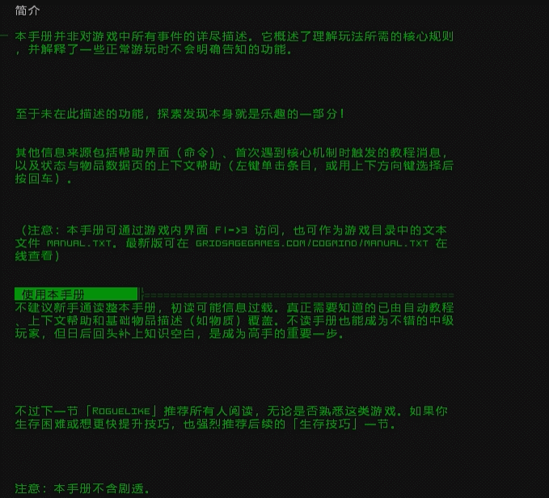

# Cogmind 中文 · 太阳莓

**按一下，让另一种语言逐字接管画面。**

  

**右 Alt＋F9**，局内切换中文与英文。新文字逐个替换旧文字，保留游戏的终端感。

支持已适配的物品名称、物品详情、终端正文、日志、警报与手册等界面。当前适配 **Windows · Cogmind Beta 17.1**。

## 安装

**[下载 v0.1.1 安装包](https://github.com/weird655/Cogmind-Sunberry-ZH/releases/download/v0.1.1/Cogmind-Sunberry-ZH-v0.1.1.zip)** · [版本说明](https://github.com/weird655/Cogmind-Sunberry-ZH/releases/tag/v0.1.1)

**独立汉化安装包，不需要 Mod 前置，不包含专属 Mod，也不需要先装前几轮补丁。** 仅支持已验证文件指纹的 Windows Beta 17.1 原版；安装器会核对版本。

1. 下载并解压，把里面的 **“cogmind汉化261019”文件夹放到游戏目录**，和 `COGMIND.exe` 放在一起。
2. 保存并退出游戏。
3. 打开“cogmind汉化261019”文件夹，双击 **`安装汉化.cmd`**，按回车。
4. 提示装好后，照常打开游戏。**右 Alt＋F9** 切换中英文。

想卸载：再打开同一个 CMD，输入 **3**。检查安装输入 **2**。

“资源”文件夹不用打开，也不要删。不要在压缩包里直接点安装。安装会备份存档，卸载不会把新进度变回旧进度。

以前装过其他汉化或 Mod 前置的，请先用原来的卸载入口恢复原版。不要把含 Mod 新物品的存档直接迁回原版。

当前源码已通过十四套离线回归；本次 DSF 链接正文与剧情弹窗已通过原生隔离测试，尚待实际游玩验收。已发布的 v0.1.1 不包含这些后续源码修复。仍可能存在未接通的界面或漏译，欢迎附截图、游戏版本和触发步骤反馈。

游戏更新后需要核验适配；目前只支持中英文切换。俄文尚需扩展字库和宽度规则，阿拉伯文还需双向排版与字形连接处理。

汉化组：太阳莓。源码公开，限非商业使用；自有框架采用 [CC BY-NC-SA 4.0](https://creativecommons.org/licenses/by-nc-sa/4.0/)。历史译表来源说明见 [NOTICE](NOTICE.md)。本项目并非游戏官方作品。

·

[实现](src/) · [构建与适配](DEVELOPMENT.md) · [贡献说明](CONTRIBUTING.md) · [许可](LICENSE)

